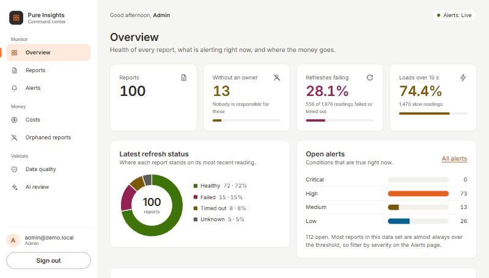
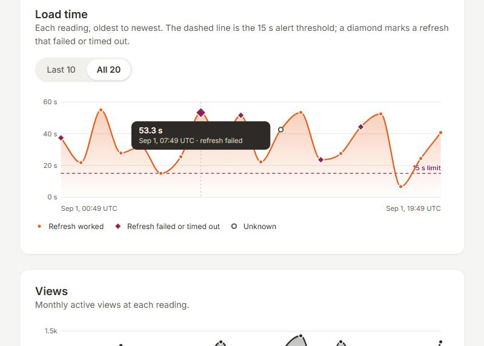

# Pure Insights Command Center

**An admin console that attributes every Snowflake credit to a report, alerts in real time on slow or failing reports, and proves its own
numbers: a separate Python implementation re-derives them from the raw CSV and the two are compared item by item (`npm run validate`).**




A candidate project for Case Study 3 (platform operational analytics). Built on synthetic data. Not an official Everpure or Pure
Storage product; the palette is inspired by their website and the layout by a public dashboard concept (see `docs/design-system.md`).

## Status

| Part | State |
|---|---|
| Data cleaning, quarantine, simulated Snowflake logs | done |
| Cost allocation SQL suite and reconciliation | done; **never run on a real Snowflake account** ([how to](docs/snowflake-run.md)) |
| REST API with login and three roles (admin, owner, viewer) | done; a test keeps the spec and the routes identical |
| Real-time alerting over WebSocket, with replay on reconnect | done |
| React dashboard: overview, fleet map, reports, alerts, costs, orphans, data quality | done, with charts |
| Independent validation in Python: 42 checks, every headline number | done, passing ([report](validation/REPORT.md)) |
| "Explain this alert": AI or rule-written, checked against the data, held for a person if unverifiable | done; run on four free local models (10 alerts each), **never on a hosted one** |

On GitHub (private for now). The first CI run there, on a clean Ubuntu machine, passed all three jobs: the data-drift check, 223 backend tests, the
Python validation, 233 frontend tests, the build and both end-to-end smoke tests.

## Quickstart (Node 22 or newer)

```bash
npm install
npm run web:install     # frontend dependencies
npm run data:build      # clean the CSV, write data/processed/
npm run web:build       # build the UI
npm start               # everything on http://localhost:3101
```

Sign in with a demo account from `backend/config/demo-users.json` (admin, two owners, one viewer). Each role sees different pages.
The "Explain" button uses rules by default. For a free local model: install [Ollama](https://ollama.com), run `ollama pull llama3.1:8b`, then
`AI_PROVIDER=ollama AI_MODEL=llama3.1:8b npm start` (PowerShell: set `$env:AI_PROVIDER` and `$env:AI_MODEL` first). Evidence stays on your computer.
Other commands: `npm run test:all` (456 tests), `npm run validate` (needs Python 3: re-derives the numbers from the raw CSV and compares),
`npm run smoke` (starts the whole product and checks it end to end), `npm run smoke:restart`, `npm run triage:eval` (add `--llm --provider ollama` to
try a local model), `npm run web:dev` (hot reload on :5173), `npm run cost:build`.
All money is US dollars, because the data's cost column is `aws_hosting_cost_usd`. Snowflake credits convert at a placeholder $3.

## What it found in the data, and how to read it

- 2,000 rows describe 100 reports (20 readings each). 24 rows have negative credits and are set aside in a ledger, not deleted.
- 13 reports currently have no owner; 74% of readings exceed the 15 s limit, so alerts are de-duplicated:
  2,026 breaching readings become 838 alerts needing attention (41%). That is a modest cut because the data is almost always "in alert".
- Attributing credits by query workload disagrees with the CSV's per-report credits for 64 of 100 reports. This is **by design** of the
  synthetic data, and shows the reconciliation can catch a mismatch. It is not evidence that any real report is mis-billed.
- The data is statistically random (columns are uncorrelated), so rankings reflect the generator, and dollar figures use a placeholder credit price.
- Every discrepancy, with evidence, impact and who to route it to, is in [`docs/validation-findings.md`](docs/validation-findings.md).

| Number | Where it comes from | How much to trust it |
|---|---|---|
| 100 reports, 24 negative-credit rows, 13 unowned | The supplied CSV, re-derived by `validation/validate.py` | Solid: counts of real file contents |
| 838 alerts from 2,026 breaching readings | My alert rules on the CSV; every alert matched one by one by the Python model | The rules are my choices; the reduction depends on this random data |
| 64 of 100 reports disagree on credits | My simulated usage logs vs the CSV; matched by the Python model | Built to be independent; shows the check works, says nothing about real billing |
| Warehouse credits equal CSV credits | Built from the CSV | True by construction; proves nothing |
| Any dollar figure | Placeholder $3 per credit | Compare reports with each other only |

The validator was written by the same person as the app, from the same written rules, so it catches slips and drift, not a wrong reading of the brief.

## Layout

```
backend/src/pipeline   cleaning, quarantine, report roll-up, simulated Snowflake tables
backend/src/warehouse  local SQLite stand-in that runs the same .sql files
backend/src/alerts     alert engine, history, telemetry replay        backend/src/realtime  WebSocket hub
backend/src/triage     "explain this alert": evidence, checker, rules, model adapters
frontend/src           React app (pages, charts, live feed client, design tokens)
sql/                   Snowflake-portable schema and cost scripts
validation/            independent Python re-derivation and its report
data/raw, processed    input and generated outputs        docs/  architecture, API spec, decisions, findings
```

## Read next

[Architecture](docs/architecture.md) | [API spec](docs/api-spec.md) | [Cost suite](docs/cost-allocation.md) | [Validation](validation/README.md) |
[Findings](docs/validation-findings.md) | [Decision log](docs/decisions.md) | [Brief map](docs/brief-map.md) | [Design system](docs/design-system.md) |
[Authorship](docs/AUTHORSHIP.md)

Licence: MIT.
