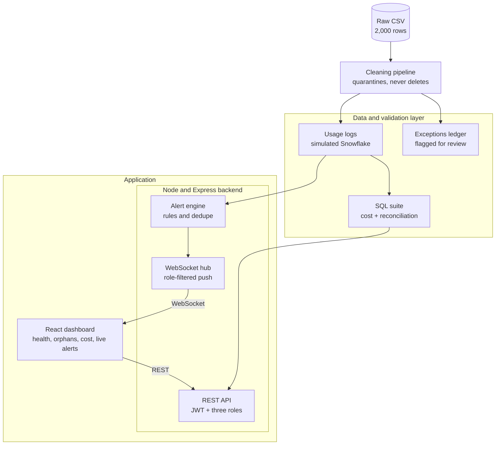
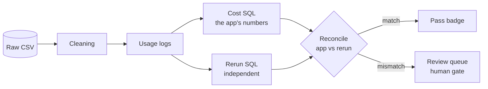

# Architecture

Four tiers. Application code (purple in the original diagram) sits above a data and validation layer; everything the dashboard
shows can be traced down to the raw CSV.



| Tier | Phase | Status |
|---|---|---|
| Cleaning pipeline, simulated tables | 1 | done (`backend/src/pipeline`, `data/processed`) |
| SQL suite (cost, reconciliation) | 2 | done (`sql/10-14`, `backend/src/cost`) |
| REST API, JWT, RBAC | 3 | done (`backend/src`, `docs/api-spec.md`) |
| Alert engine, WebSocket hub, telemetry replay | 4 | done (`backend/src/alerts`, `backend/src/realtime`) |
| React dashboard | 5 | done (`frontend/src`, served by the API server) |
| AI explanations: evidence, validator, review queue | 7 | done (`backend/src/triage`); local model run on 10 alerts |

## Validation loop

The app's cost numbers are checked against an independent rerun of the SQL. A match shows a pass badge. A mismatch goes to a
human review queue instead of being trusted silently.



## Where each tier lives

```
backend/src/pipeline/    cleaning, quarantine, report roll-up, simulated Snowflake tables, DQ report
backend/src/warehouse/   local SQLite stand-in that runs the same .sql files (D9)
backend/src/cost/        runs sql/10-14
sql/                     Snowflake-portable schema and cost scripts
data/raw, data/processed input and generated outputs
frontend/src/styles/     design tokens
```
